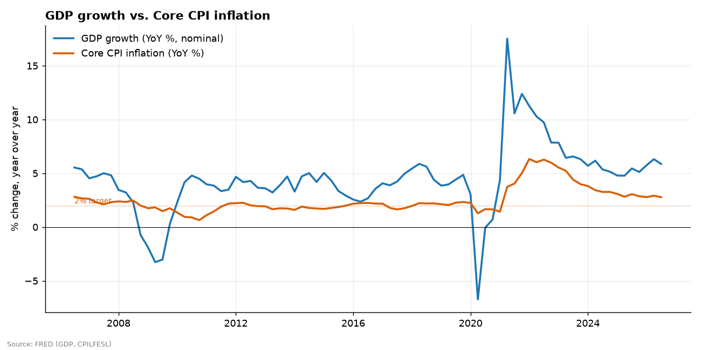

# Sample conversations

Generated by script run in mode: **offline rule-based (set ANTHROPIC_API_KEY for the LLM)** on live FRED data (latest GDP 2026 Q3, Core CPI Oct 2026).

**You:** What is the latest reported U.S. GDP?

**Bot:** The latest reported U.S. GDP is **$33,010.0 billion** (2026 Q3, nominal, seasonally adjusted annual rate), ≈ $33.01 trillion. That is 5.61% annualized growth vs the prior quarter and 5.87% vs a year earlier.

**You:** How has U.S. GDP changed over the past 10 years?

**Bot:** From 2016 Q3 to 2026 Q3, GDP rose from $18,893B to $33,010B (**+74.7%**, 5.74%/yr CAGR). Average YoY growth was 5.62%. Weakest: 2020 Q2 (-6.73%); strongest: 2021 Q2 (+17.53%). Note GDP here is nominal, so growth includes inflation.

**You:** What is the current Core CPI inflation rate?

**Bot:** Core CPI inflation is **2.87% year over year** (October 2026; index 339.9). Month over month: 0.3%; 3-month annualized: 3.75%.

**You:** How has Core CPI inflation changed over the past five years?

**Bot:** From Oct 2021 to Oct 2026 core prices rose **20.7%** (index 281.67 → 339.9). YoY inflation peaked at 6.62% (Sep 2022), bottomed at 2.67% (Mar 2026), and is now 2.87%. YoY by year-end: 2021: 5.49%, 2022: 5.69%, 2023: 3.92%, 2024: 3.21%, 2025: 2.84%, 2026: 2.87%.

**You:** What is the relationship between GDP growth and Core CPI inflation?

**Bot:** Over 2006 Q3 to 2026 Q3 (81 quarters), YoY GDP growth and Core CPI inflation have a correlation of **0.653** (0.682 excluding 2020-21). Correlation with GDP leading CPI by 2 quarters is 0.715, the strongest lag tested. Averages: GDP 4.46%, CPI 2.51%. Latest: GDP 5.87%, CPI 2.78%. Caveat: a positive link is consistent with demand-driven inflation, but nominal GDP mechanically includes prices, and correlation is not causation.

**You:** Generate a visualization comparing GDP growth and Core CPI inflation over time.

**Bot:** Here is the comparison chart (saved to `/Users/jj/Desktop/sjsu/recommender/conversational-ai/outputs/comparison_20y.png`). GDP growth is nominal (it includes inflation); note the 2020 shock and the 2021-22 inflation surge.

**You:** Summarize the key economic trends observed in both datasets.

**Bot:** **Key trends**
- GDP: $33,010B in 2026 Q3, 5.87% YoY vs 4.06% average in 2010-19; fell to -6.73% YoY in 2020 Q2, then rebounded sharply.
- Core CPI: 2.87% YoY (October 2026), down from a 6.62% peak in Sep 2022, but above the 1.85% 2010-19 average; direction over the last 12 months: falling.
- Relationship: correlation 0.653 over 2006 Q3 to 2026 Q3; strongest when GDP leads CPI by ~2 quarters.

